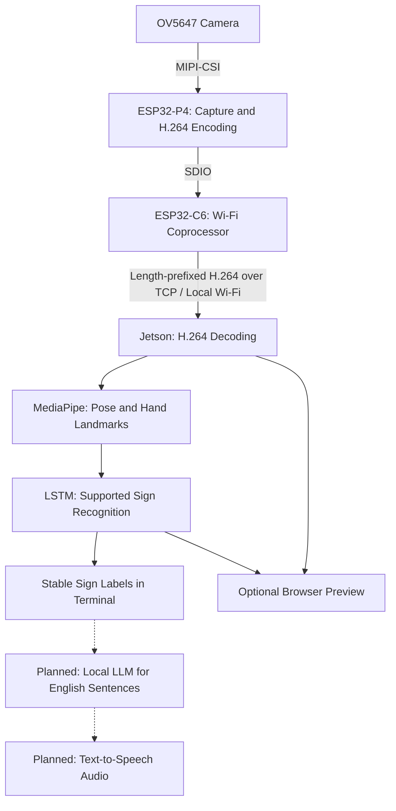

# Team 20 (NARM) : Offline ASL Recognition Device

CMPE 195B - Senior Design Project II | San Jose State University | Fall 2026

## Team

| Name | GitHub | Email |
| --- | --- | --- |
| Newton Tran | [@pringlessingles](https://github.com/pringlessingles) | newton.tran@sjsu.edu |
| Robert Trinh | [@under-dogeey](https://github.com/under-dogeey) | robert.trinh@sjsu.edu |
| Aaron Jimenez | [@ajimenez8203](https://github.com/ajimenez8203) | aaron.jimenez@sjsu.edu |
| Min Khant Ko Ko | [@mkhantkk](https://github.com/mkhantkk) | minkhant.koko@sjsu.edu |

**Advisor:** Kaikai Liu

## Project Description

NARM is a prototype for camera-equipped glasses that help bridge communication between ASL users and people who do not understand ASL. An ESP32-P4 streams video over local Wi-Fi to a Jetson, where pose and hand landmarks feed a trained model that recognizes supported signs. The intended product adds English sentence generation and spoken output; those stages are still planned.

## Prototype Scope

### Implemented in the current code

- OV5647 camera capture and hardware H.264 encoding on the Waveshare ESP32-P4-WIFI6.
- Video transmission through the board's ESP32-C6 Wi-Fi coprocessor to a Python TCP receiver on the Jetson.
- H.264 decoding, MediaPipe Pose + Hands feature extraction, and TensorFlow/Keras LSTM inference.
- A supplied model for **hello**, **thanks**, and **iloveyou**. Its [metadata](jetson-code/models/model_meta.json) specifies 258 features per frame and a 20-frame window.
- Confidence, stability, and hand-presence checks before reporting a recognized sign.
- Terminal predictions and an optional browser preview with video, landmarks, probabilities, and recent recognized words.
- Automatic streaming after Wi-Fi connects, plus BOOT-button stop/restart control.

The current firmware targets **1920x1080 capture output at 15 FPS**. This is a configuration target, not a measured guarantee of video throughput or recognition speed. The sensor stays in its native 1080p30 mode and the driver delivers every other frame.

### Limitations and incomplete work

- Recognition is limited to the supplied vocabulary; this is not a general ASL translator.
- English sentence generation with a local LLM and text-to-speech audio are not implemented.
- The preview's recent-word bar is a sequence of recognized labels, not an English sentence generated by an LLM.
- Live accuracy, latency, and sustained FPS must be demonstrated on the physical system. A passing unit test or firmware build does not establish these measurements.
- Glasses packaging, power integration, and validation across additional signers remain unfinished.
- There is no interactive hardware simulator or recorded-video replay command. Hardware-free logic checks are documented under **Testing**.
- A public source/build recipe for the team's Jetson container image is still pending. The current prototype video is linked under **Demo**, but a full 3-5 minute narrated submission video is still needed.

Runtime recognition uses the local network and requires no cloud inference service. Initial tool installation, package downloads, and MediaPipe model caching can require internet access.

## System Architecture



Each TCP message contains a 4-byte big-endian payload length followed by one H.264 access unit. The Jetson decodes compressed video in order; when inference falls behind, it may replace older decoded RGB frames with newer ones. The browser preview runs on the Jetson and is separate from the ESP32's alternate camera-only browser modes.

The main components are in [esp32-p4/](esp32-p4/), [jetson-code/](jetson-code/), and [training/](training/). Mechanical designs are in [glassesparts/](glassesparts/). The [streaming runbook](docs/esp32_jetson_streaming_runbook.md) contains additional troubleshooting; use the model path and frame-stride settings below for this snapshot.

## Prerequisites

| Area | Requirement |
| --- | --- |
| Camera hardware | Waveshare ESP32-P4-WIFI6 with its ESP32-C6 coprocessor, OV5647 camera and MIPI-CSI ribbon, suitable power supply, and USB data cable for flashing/monitoring |
| Inference hardware | Jetson Orin Nano Super, as documented by the current [Jetson setup](jetson-code/README.md); the exact installed JetPack 6 minor release still needs to be recorded |
| Local networking | A shared 2.4 GHz Wi-Fi network or Jetson-hosted hotspot; NetworkManager is needed for the optional hotspot commands |
| Firmware toolchain | ESP-IDF **5.4.4** (the version used by CI), Git, CMake, and the tools installed by ESP-IDF |
| Jetson software | JetPack **6** environment, Docker Engine and the team's compatible container image; Python **3.10** inside the container |
| Python runtime | TensorFlow **2.15.1**, Keras **2.15**, MediaPipe **0.10.18**, NumPy **1.26.4**, protobuf **4.25.9**, OpenCV headless **4.10.0.84**, and PyAV **17.0.0** |
| Hardware-free tests | Python **3.10**, NumPy, OpenCV headless, and GCC; TensorFlow, MediaPipe, a Jetson, and a camera are not required for these mocked unit tests |
| Optional browser tests | Node.js **18 or newer** |
| Accounts | No paid service or API account is required at runtime; repository access is needed to clone, and demo viewers must be able to open the final video without signing in |

The commands below use **Bash on Ubuntu 22.04**. For Windows firmware development, install the same ESP-IDF release and use its configured PowerShell environment; replace serial-port and activation commands with their Windows equivalents. Keep the firmware toolchain, host-test virtual environment, and Jetson container environments separate.

## Installation

### 1. Clone the repository

On the development computer, and separately on the Jetson host:

```bash
sudo apt-get update
sudo apt-get install -y git python3 python3-pip python3-venv build-essential
cd "$HOME"
git clone https://github.com/SJSU-CMPE-195/group-project-team-narm.git
cd "$HOME/group-project-team-narm"
```

For grading, check out `impl2-v1` once the team has published that tag. Cloning the default branch alone does not select the graded snapshot.

### 2. Prepare the hardware-free test environment

From the repository root on a development computer:

```bash
python3 -m venv .venv
source .venv/bin/activate
python -m pip install --upgrade pip
python -m pip install numpy==1.26.4 opencv-python-headless==4.10.0.84
```

Use the commands in **Testing** to exercise the existing software logic without a board. Run `deactivate` before activating ESP-IDF in the same terminal, or use separate terminals.

### 3. Install ESP-IDF and build the camera firmware

On the development computer, follow the [ESP-IDF 5.4.4 setup guide](https://docs.espressif.com/projects/esp-idf/en/v5.4.4/esp32p4/get-started/linux-macos-setup.html). The Ubuntu commands are:

```bash
sudo apt-get install -y wget flex bison gperf cmake ninja-build ccache libffi-dev libssl-dev dfu-util libusb-1.0-0
mkdir -p "$HOME/esp"
git clone -b v5.4.4 --recursive https://github.com/espressif/esp-idf.git "$HOME/esp/esp-idf"
cd "$HOME/esp/esp-idf"
./install.sh esp32p4
. ./export.sh

cd "$HOME/group-project-team-narm/esp32-p4"
idf.py set-target esp32p4
idf.py menuconfig
```

In `menuconfig`:

1. Under **Example Connection Configuration**, enter the local Wi-Fi SSID and password.
2. Under **Camera Streaming Configuration -> Streaming mode**, select **Send H.264 over TCP to Jetson**.
3. Set the Jetson IP to its actual address on that network and the TCP port to match the receiver.
4. Use capture dimensions **1920x1080** and capture output **15 FPS**.
5. Keep stream toggle GPIO **35** for the onboard BOOT button, and enable **Start streaming automatically after Wi-Fi connects**.
6. Preserve the checked-in Waveshare camera, ESP32-C6 SDIO, flash, and PSRAM settings.

```bash
idf.py build
```

A board is not required to compile. The first build downloads managed components. Existing `sdkconfig` values override `sdkconfig.defaults`; only use `set-target` when configuring a fresh checkout or changing the target, because it resets local configuration. Enter real credentials locally and do not commit them.

### 4. Prepare the Jetson inference environment

The component documentation describes a JetPack 6 container using this **team-local image tag**:

```text
tensorflow2:2.21.0-r36.4.tegra-aarch64-cu126-22.04-tensorflow2_2.21.0
```

**Provisioning limitation:** a public registry URL, Dockerfile, or image archive source has not yet been supplied. A clean Jetson requires that image to be obtained from the team before the following container commands can run. The image's tag is not a claim that the application uses TensorFlow 2.21; the package installation below selects the model-compatible 2.15.1 stack.

On the Jetson host, from the cloned repository root, after obtaining the image:

```bash
JETSON_IMAGE=tensorflow2:2.21.0-r36.4.tegra-aarch64-cu126-22.04-tensorflow2_2.21.0
docker image inspect "$JETSON_IMAGE"
docker run -it --name asl_infer --net=host \
  -v "$PWD:/workspace/group-project-team-narm" \
  "$JETSON_IMAGE" bash
```

Inside the new container:

```bash
cd /workspace/group-project-team-narm/jetson-code
apt-get update
apt-get install -y libxcb1
export PIP_INDEX_URL=https://pypi.jetson-ai-lab.io/jp6/cu126
python3 -m pip install --upgrade pip setuptools wheel
python3 -m pip install "matplotlib==3.10.8" --only-binary=:all:
python3 -m pip install -r requirements.txt
python3 -m pip install "mediapipe==0.10.18" --no-deps
export PROTOCOL_BUFFERS_PYTHON_IMPLEMENTATION=python
python3 -c "import tensorflow, mediapipe, cv2, av, numpy; print('dependencies imported')"
test -f models/action_3word_noface.h5
test -f models/model_meta.json
```

Keep `action_3word_noface.h5` and `model_meta.json` together in `jetson-code/models/`. Use the checked-in `asl_features.py` that matches the model's feature layout. The legacy `action.h5` model uses a different layout and is not the model for this prototype.

Complete a first inference startup while internet is available so any required MediaPipe landmark assets are cached before an offline demonstration. Further package and container troubleshooting is in [jetson-code/README.md](jetson-code/README.md).

### 5. Configure networking and environment variables

The ESP32 and Jetson must share a local network. On the Jetson host, inspect available interfaces with `nmcli device status`. If using an existing router or hotspot, configure the ESP32 to join it and use the Jetson's address on that network.

For an optional Jetson-hosted hotspot, supply the interface and credentials interactively:

```bash
read -r -p "Wi-Fi interface: " WIFI_INTERFACE
read -r -p "Hotspot SSID: " WIFI_SSID
read -r -s -p "Hotspot password: " WIFI_PASSWORD
sudo nmcli device wifi hotspot ifname "$WIFI_INTERFACE" \
  con-name ASLHotspot ssid "$WIFI_SSID" password "$WIFI_PASSWORD"
ip -4 addr show dev "$WIFI_INTERFACE"
unset WIFI_PASSWORD
```

Use the reported IPv4 address in the ESP32 configuration. Allow the receiver TCP port and optional preview HTTP port on this local network.

The Python application reads shell environment variables directly; it does not automatically load a `.env` file. The root [.env.example](.env.example) lists non-secret example settings and optional model overrides. When creating a new local configuration, copy it to the ignored `.env` file and edit as needed. From the repository root inside the prepared Jetson environment, load it with:

```bash
set -a
. ./.env
set +a
python3 jetson-code/main.py
```

The template's relative `MODEL_PATH` assumes startup from the repository root. The [impl.yaml](impl.yaml) run command also loads a local `.env` when present. No real Wi-Fi credentials or private tokens belong in this README or tracked configuration.

| Variable | Purpose |
| --- | --- |
| `MODEL_PATH` | Required path to the supported trained model |
| `PROTOCOL_BUFFERS_PYTHON_IMPLEMENTATION` | Select the protobuf implementation used by the documented container startup |
| `HOST`, `PORT` | TCP receiver bind address and port |
| `PAYLOAD_FORMAT` | Match the sender's H.264 or legacy JPEG framing |
| `FRAME_STRIDE` | Select every Nth decoded frame before inference queuing |
| `ACTIONS`, `SEQUENCE_LENGTH` | Override the model's class labels and input window; must remain compatible with the model |
| `FRAME_SIZE`, `INFER_WIDTH` | Control model-input crop/resize geometry |
| `MODEL_COMPLEXITY`, `PARALLEL_MEDIAPIPE` | Configure MediaPipe processing |
| `MIN_HAND_FRAC`, `THRESHOLD`, `STABLE_N`, `REPEAT_RESET` | Configure hand-presence gating and stable prediction reporting |
| `PAYLOAD_QUEUE_SIZE`, `DECODED_QUEUE_SIZE` | Bound the compressed-input and decoded-frame queues |
| `STATS_INTERVAL_SEC` | Set the performance reporting interval |
| `PREVIEW_HTTP`, `PREVIEW_PORT` | Enable and bind the browser preview |
| `PREVIEW_FPS`, `PREVIEW_WIDTH`, `PREVIEW_JPEG_QUALITY` | Control preview rendering |
| `PREVIEW_LANDMARKS`, `PREVIEW_MAX_SENTENCE` | Control landmark overlays and the number of recent labels shown |

Model settings normally come from `model_meta.json`; environment variables override individual settings. Leave the trained window, labels, and geometry unchanged unless using a compatible replacement model.

## Running the Prototype

### 1. Start the Jetson receiver

If the prepared container is stopped, enter it from the Jetson host:

```bash
docker start -ai asl_infer
```

If it is already running, use `docker exec -it asl_infer bash` instead. Inside the container:

```bash
cd /workspace/group-project-team-narm/jetson-code
export PROTOCOL_BUFFERS_PYTHON_IMPLEMENTATION=python
export MODEL_PATH=/workspace/group-project-team-narm/jetson-code/models/action_3word_noface.h5
export PAYLOAD_FORMAT=h264
export FRAME_STRIDE=1
export PREVIEW_HTTP=1
python3 main.py
```

**Frame timing matters:** use `FRAME_STRIDE=1` with the current 15 FPS firmware. The model metadata specifies stride 2 for 30 FPS training capture; leaving that value unchanged on a 15 FPS stream samples only every other arriving frame. If using 30 FPS firmware, use stride 2.

### 2. Flash and start the ESP32-P4

Connect the camera to the board's MIPI-CSI connector and the board to the development computer with a USB data cable. In the ESP-IDF terminal:

```bash
. "$HOME/esp/esp-idf/export.sh"
cd "$HOME/group-project-team-narm/esp32-p4"
read -r -p "ESP32 serial port: " ESP32_PORT
idf.py -p "$ESP32_PORT" flash monitor
```

Use the actual serial port, such as a Linux `/dev/ttyACM*` device or Windows `COM*` port. After Wi-Fi connects, the board starts streaming automatically. Release BOOT during reset; after startup, press BOOT to stop streaming and press it again to restart.

For an already flashed board, power/reset it and use `idf.py -p "$ESP32_PORT" monitor` to view logs. Exit the ESP-IDF monitor with **Ctrl+]**.

### 3. View predictions and complete a user journey

1. On the same local network, open `http://JETSON_IP:8000/`, replacing `JETSON_IP` with the receiver's actual IPv4 address. The TCP ingest port is not a browser endpoint.
2. Keep the signer's upper body and hands visible in the camera image.
3. Perform a supported sign: **hello**, **thanks**, or **iloveyou**.
4. Observe the predicted label in the Jetson terminal and recent-word preview. Reporting starts only after the input window, confidence, hand-presence, and stability checks are satisfied.
5. Stop and restart the stream with BOOT to check reconnect behavior. Stop the receiver with **Ctrl+C** when finished.

Expected log formats below are illustrative, not benchmark measurements:

```text
ESP32:
connected to Jetson at <receiver-ip>:<tcp-port>
video started
stats: encoded=... sent=... fps=... bitrate=... queue=... age=...ms

Jetson:
[tcp] listening on 0.0.0.0:5000
[tcp] client connected: (...)
[stats] rx=...fps/...Mbps decode=...fps infer=...fps ...
[gloss] hello (conf=...)
```

No predictions while the receiver is waiting for frames is expected. For connection failures, check the SSID, receiver IP, matching TCP ports, and sender mode. For model-shape errors, check the no-face model path and matching metadata. For slow recognition, compare receive, decode, and inference rates separately.

## Testing

### Hardware-free logic checks

The root [impl.yaml](impl.yaml) describes setup, firmware build, live startup, and verification commands. Its `mock_mode` uses the unit tests and C harnesses below; it is not an interactive camera simulator. Run its `setup` commands first. Firmware compilation still requires an activated ESP-IDF environment, and live startup still requires the prepared Jetson runtime and camera hardware.

From the repository root, activate the environment prepared in Installation step 2:

```bash
source .venv/bin/activate
python -B -m unittest discover -s jetson-code/tests -v
python -B -m unittest discover -s esp32-p4/tests -p 'test_jetson*.py' -v
```

| Tests | Coverage |
| --- | --- |
| `jetson-code/tests/test_infer_speedups.py` | Feature layout, model-shape validation, metadata/environment configuration, frame sampling and geometry, parallel detector behavior, hand gating, and stable-label reporting using test doubles |
| `jetson-code/tests/test_queue_policy.py` | Decoded-frame queue replacement and pipeline statistics |
| `jetson-code/tests/test_tcp_ingest_server.py` | Stream reconnect and incomplete-frame handling |
| `esp32-p4/tests/test_jetson_stream_control.py` | Firmware button, stop/restart, and cancelled-connect behavior in a host C harness |
| `esp32-p4/tests/test_jetson_buffer_backpressure.py` | Slow-receiver backpressure, output-buffer return, reconnect, and failed requeue behavior in a host C harness |

OpenCV-dependent checks are skipped if OpenCV is absent, and the firmware harness checks are skipped if GCC is absent. Install both for full coverage of these commands. These mocked checks exercise logic without physical hardware; they do not run a live camera session or measure trained-model accuracy.

An optional browser-player suite runs without the board:

```bash
node --test esp32-p4/tests/test_h264_player.mjs
```

Additional C resize and MP4 muxer checks are documented in [esp32-p4/README.md](esp32-p4/README.md).

### Firmware compilation and physical validation

From an activated ESP-IDF terminal:

```bash
cd "$HOME/group-project-team-narm/esp32-p4"
idf.py build
```

For physical validation, follow **Running the Prototype**, demonstrate each supported sign, check BOOT stop/restart, and record measured video/inference rates and observed failures. Keep held-out signer testing separate from training results.

The [CI workflow](.github/workflows/ci.yml) checks formatting, firmware compilation, and selected host sanity tests. In the [published run reviewed on October 25, 2026](https://github.com/SJSU-CMPE-195/group-project-team-narm/actions/runs/40251556397), formatting and firmware compilation passed, but the slow-TCP-receiver sanity step failed. That Linux CI failure remains to be investigated; passing local checks alone do not resolve it.

## Demo

**Current prototype video:** [Link to Prototype Demo](https://drive.google.com/file/d/1A4Y7zdy7tJOgDVsvDLxaS4mWCQmrubZf/view?usp=sharing).

The checked-in clip is approximately **51 seconds** long. It provides a video artifact, but does not meet the assignment's required **3-5 minute** duration. Expand or replace it with the final narrated demonstration, and verify playback without signing in before submission.

The final demonstration should show the physical camera and board, a person performing supported signs, communication/processing evidence, and the resulting predictions. Include at least one complete user journey and briefly identify incomplete features. The clip's narration and end-to-end coverage have not yet been verified.

### Earlier development evidence

These links are retained as development history; their duration, narration, and coverage have not been verified against the final prototype-demo requirements.

| Evidence | Link |
| --- | --- |
| Raspberry Pi trial 1 | [View video](https://drive.google.com/file/d/1KT8tJLhU8_RAIu3LAAFUE22tZD822viF/view?usp=drive_link) |
| Raspberry Pi trial 2 | [View video](https://drive.google.com/file/d/14Ed6Ce-xtvRCOp3gI132woxyjiATuiI4/view?usp=drive_link) |
| Earlier H.264 browser streaming trial | [View video](https://drive.google.com/file/d/1kxpYcOKgZbU-y9zeQ-B9SgL2epeLz3yH/view?usp=drive_link) |

The following screenshot records an earlier browser-stream FPS demonstration. It is not evidence of current recognition throughput or end-to-end latency.


## Technical Stack

| Component | Technology and role |
| --- | --- |
| Firmware | C, ESP-IDF 5.4.4, and the ESP32-P4 hardware video encoder |
| Camera | OV5647 connected over MIPI-CSI |
| Wireless | ESP32-C6 connected to the ESP32-P4 over SDIO; local Wi-Fi and TCP |
| Video transport | Length-prefixed H.264 access units |
| Inference platform | Jetson Orin Nano Super, JetPack 6, and the documented Python 3.10 container environment |
| Video decoding and processing | PyAV 17.0.0, OpenCV headless 4.10.0.84, and NumPy 1.26.4 |
| Feature extraction | MediaPipe 0.10.18 Pose + Hands, producing 258 values per frame |
| Recognition | TensorFlow 2.15.1 / Keras 2.15 LSTM with companion model metadata |
| Preview | Python HTTP server and MJPEG browser display; alternate ESP32 browser mode uses HTML/JavaScript and fragmented MP4 |
| Training and collection | Python notebooks, labeled video clips, and the shared landmark extractor |
| Verification | Python unittest, GCC host harnesses, optional Node.js tests, and GitHub Actions |
| Mechanical design | CAD/STL glasses and enclosure parts under `glassesparts/` |

The prototype does not use a database or a cloud recognition API. The planned local LLM and audio pipeline are not part of the current runtime stack.

## What's Next

### Before the Implementation 2 submission is complete

- Expand or replace the linked 51-second prototype clip with a public 3-5 minute narrated demo showing the real recognition system, and include that final link in the submission.
- Run the commands in [impl.yaml](impl.yaml) in the documented environments and review its hardware requirements, known limitations, and demo evidence before tagging the submission.
- Review [.env.example](.env.example) for the target environment and keep real credentials in ignored local configuration.
- Publish the Jetson image source or build recipe and record the exact JetPack release.
- Investigate the failing Linux CI sanity check and rerun verification.
- Commit and publish the final changes, tag the exact graded commit `impl2-v1`, push the tag, and submit the repository and demo links on Canvas. A pull request alone does not create the required tag or Canvas submission.

### Planned work before the Project Expo on December 11, 2026

- Expand the vocabulary and evaluate recognition with held-out signers and realistic lighting/backgrounds.
- Integrate local English sentence generation from recognized sign sequences.
- Integrate offline text-to-speech and the wearer's audio output.
- Reduce latency and measure sustained capture, decode, inference, and preview performance.
- Complete glasses/enclosure, power, and usability integration.
- Provide a reproducible Jetson image and a recorded-input workflow for evaluating the complete software pipeline without the camera hardware.
